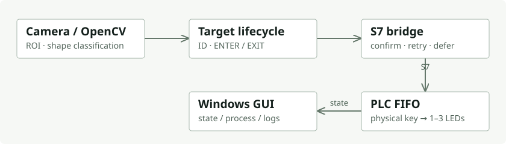
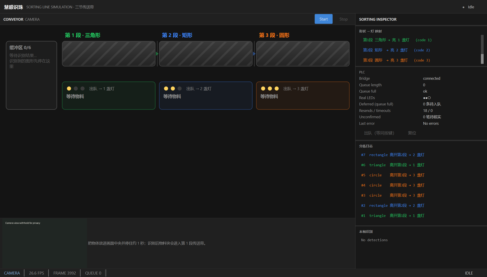

# 慧眼识珠 · 视觉与 PLC 分拣集成

摄像头识别三种几何物料，PC 把目标事件送入 PLC FIFO，实体按键推进队列，1–3 盏灯表示分拣结果。这个已结项的综合实验把视觉识别、通信确认、排队和现场 I/O 串成了一条可追踪的链路。

我负责视觉与 GUI、接口规范、集成和验收；PLC 程序由团队协作完成，我参与开发与联调。同一项目的 [i.MX6ULL 分支](https://github.com/lls144/huiyan-shizhu-imx6ull) 用 Linux 控制器、三工位 FSM 与 LCD HMI 替代 PLC 后端。





真实相机与 PLC 的一次干净复跑：7 条派发全部确认，含 18 次重发和 1 条队列满延后。左下相机区域因现场人员隐私遮蔽；状态与日志保留。GUI 传送带是过程演示，实体执行反馈为按键和 LED。

## 读代码，从这几处开始

| 环节 | 设计与代码 |
|---|---|
| 识别 | [pc/vision](pc/vision)：ROI、阈值分割、轮廓分类；保留遮挡与粘连失败样例 |
| 生命周期 | [pc/events](pc/events)：目标 ID、确认、ENTER / EXIT，避免停留目标重复派发 |
| 操作界面 | [pc/gui](pc/gui) 与 [pc/sorting](pc/sorting)：采集、状态监视、分拣动画和日志 |
| 通信 | [pc/communication](pc/communication)：写入确认、重发和连接状态 |
| PLC | [plc/](plc/README.md)：SCL、I/O 映射、TIA 编译步骤与真机测试工具 |
| 离线回归 | [simulator](simulator)、[tests](tests)：确定性 Fake PLC；不等同于硬件验收 |

## 工程记录

- **命令写了，为什么没确认？** 初次闭环出现 `UNCONFIRMED`；增加确认复读和 `safe_init` 后，7 次派发全部确认。重发仍发生，记录保留了这个过程。
- **看门狗触发了，灯为什么不闪？** 告警已成立，但 FB 实例输出未刷新到最终灯输出；改为明确赋值后，实测全闪约 2.026 Hz。
- **相机换了，旧验收是否仍成立？** 更换为内置 HD Webcam 后重做多目标、GUI 长跑和带目标运行；自动曝光让“较暗”场景未成立，未把它算作验证通过。

[调试过程与验收证据](docs/ACCEPTANCE.md) · [架构与接口](docs/ARCHITECTURE.md) · [完整文档入口](docs/INDEX.md)

## 先在电脑上运行

Python 3.12，建议独立虚拟环境：

```powershell
python -m venv .venv
.\.venv\Scripts\Activate.ps1
python -m pip install -r requirements.txt
python -m pc.gui --source synthetic
python -m pytest -q pc/tests tests plc/tests
```

此入口使用合成画面，不连接 PLC。真实相机、PLC 依赖及地址配置见 [运行指南](docs/GETTING_STARTED.md)。公开配置使用文档示例网段，连接硬件前必须改为现场参数。

[个人作品集](https://github.com/lls144) · [Linux 控制与 HMI](https://github.com/lls144/huiyan-shizhu-imx6ull) · [公开版本与素材说明](docs/PUBLICATION.md)
