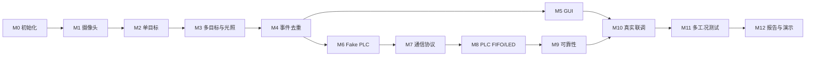

# 实验计划

详细输入、任务、验收、硬件条件以 `../docs/ROADMAP.md` 为准。

## 四周开发顺序

## 状态

- [x] M0 项目初始化
- [x] M1 USB 摄像头稳定采集
- [x] M2 单目标轮廓识别
- [ ] M3 多目标识别与抗光照
- [ ] M4 防重复识别/事件生成
- [ ] M5 GUI 上位机
- [ ] M6 Fake PLC 模拟器
- [ ] M7 PC-PLC 通信协议
- [ ] M8 PLC FIFO 与 LED 逻辑
- [ ] M9 心跳、超时重发、队列满处理
- [ ] M10 实验室真实 PLC 联调
- [ ] M11 多工况系统测试
- [ ] M12 报告、PPT、演示视频整理

> [!warning] 排期说明
> 任务书写明 8 月 31 日至 9 月 25 日共 4 周、覆盖第 17～19 教学周，但原进程表中间阶段名称不完整。本页只给出工程依赖顺序，不冒充缺失的课程排期。

## 当前阶段边界

- 已收到 10 张真实拍摄图片：1 张空背景、每类目标各 3 张；原始图片位于被 Git 忽略的 `test_data/raw/m2/`。
- 离线单目标识别已由项目负责人确认，记录见 [[tests/TEST-002-M2-离线单目标轮廓识别]]。
- [[tests/TEST-003-M2-实时摄像头与ROI验收]] 已完成原机位 manual ROI 和改变机位后 auto ROI 的 8 项真实测试，结果为 PASS。
- M2 已完成；下一 milestone 为 M3，但未经明确用户指令不得开始。
- M3 多目标与抗光照、GUI、PLC 和通信仍在边界外。
